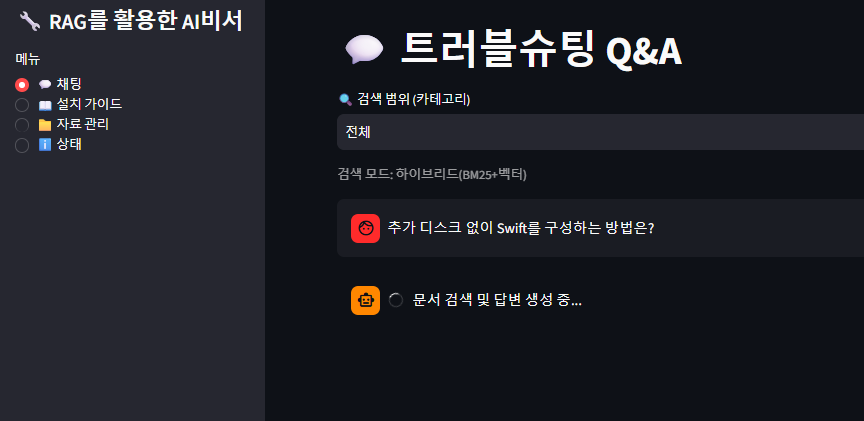
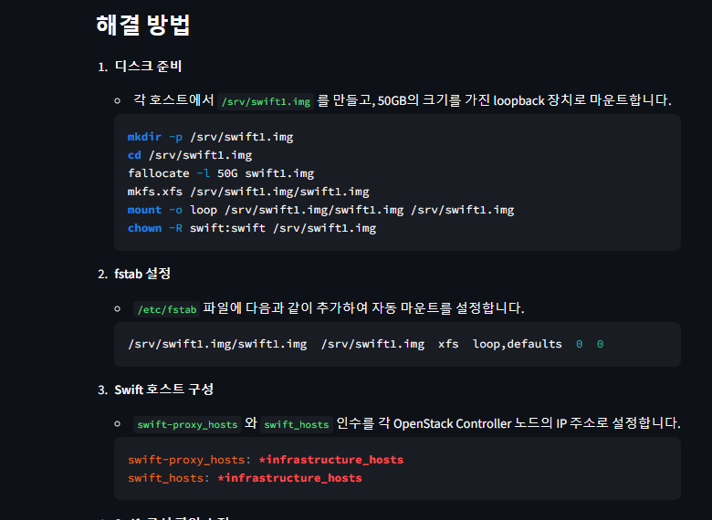
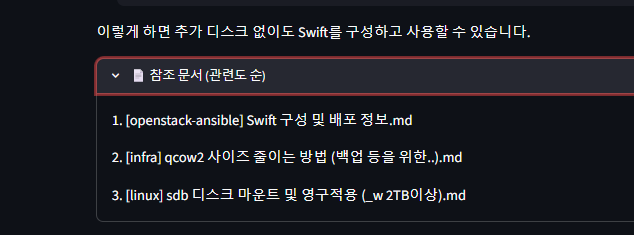
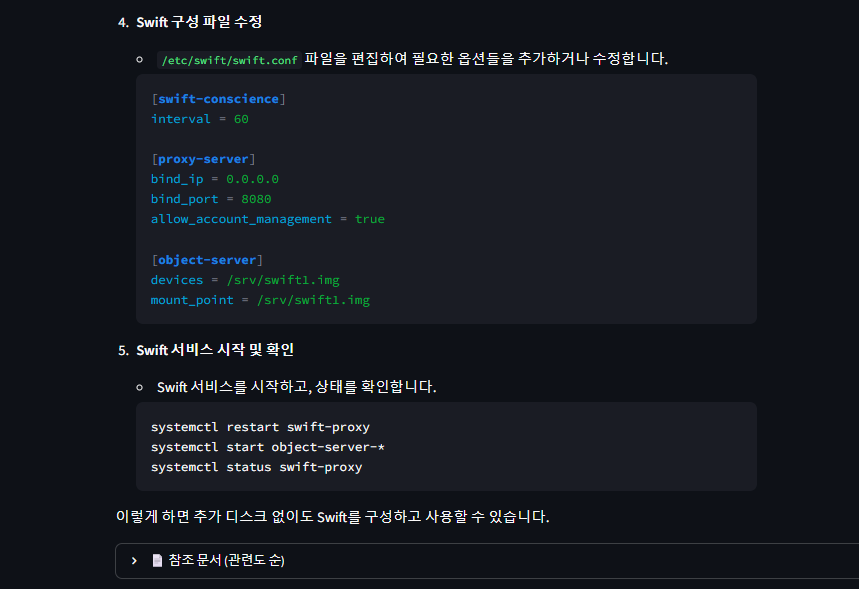
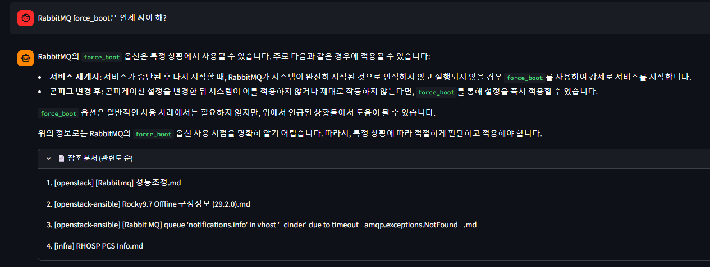
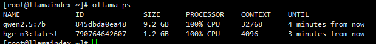

인프라 엔지니어로 일하면서 Notion에 운영 노트를 꾸준히 쌓아 왔습니다. OpenStack, RHOSP, OpenShift, Ceph, 네트워크, 리눅스까지 650개가 넘습니다.

문제는 **정작 필요할 때 찾기 어렵다**는 것이었습니다. 장애 현장에서 "예전에 RabbitMQ가 이렇게 깨졌을 때 어떻게 했더라?"를 떠올리려면 제목을 기억하거나 검색어를 정확히 맞혀야 합니다.

그래서 이 노트들을 근거로 답하는 **로컬 AI 비서**를 만들었습니다. 조건은 두 가지였습니다.

- **GPU 없이** 평범한 KVM VM 한 대에서 돌 것
- 외부 API 없이 **완전 로컬**로 동작할 것 (폐쇄망 현장을 가정)

## 0. 한눈에 보기

| 항목 | 값 |
|---|---|
| 실행 환경 | KVM VM 1대, Rocky Linux 9, **16 vCPU / 62GB / GPU 없음** |
| LLM | `qwen2.5:7b` (Ollama, Q4_K_M 양자화, 4.7GB) |
| 임베딩 | `bge-m3` (Ollama, 1024차원, 다국어) |
| 벡터 DB | ChromaDB (로컬 파일) |
| 검색 | **하이브리드**: 벡터 검색 + BM25 키워드 검색 → RRF로 결합 |
| 프레임워크 · UI | LlamaIndex · Streamlit |
| 데이터 | Notion DB 25개 → Markdown 650개 → 청크 1,193개 |

## 1. 구조

```
[Notion DB 25개]
      │  fetch_notion.py  (Notion API → 페이지 단위 Markdown)
      ▼
data/<카테고리>/*.md  (650개, 카테고리 10개)
      │  build_index.py
      │   ├ 문서 로드 + 카테고리 메타데이터
      │   ├ 청크 분할 (1024 토큰, overlap 100)
      │   ├ bge-m3 임베딩 → ChromaDB      (의미 검색용)
      │   └ 원문 저장     → docstore      (키워드 검색용)
      ▼
app.py (Streamlit)
   ├ 💬 채팅       : 하이브리드 검색 → qwen2.5 답변 + 참조 문서
   ├ 📖 설치 가이드 : 문서 1개를 통째로 넣어 단계별 가이드 생성
   ├ 📁 자료 관리   : 문서 업로드 + 재인덱싱
   └ ℹ️ 상태        : 문서 · 청크 수
            │
            ▼
   Ollama (127.0.0.1:11434)  ─ qwen2.5:7b, bge-m3
```

모든 구성 요소가 **VM 한 대 안에서** 동작합니다. 컨테이너도 쓰지 않고 호스트에 직접 설치했습니다.

## 2. 데이터가 먼저다

### 2-1. 페이지 단위로 쪼개서 수집

처음에는 Notion을 통째로 내보낸 Markdown을 넣었습니다. 그랬더니 **엉뚱한 문서를 근거로 답하는** 일이 잦았습니다. 한 파일에 여러 사례가 뭉쳐 있어서, 청크를 나눌 때 주제 경계가 무시되고 검색이 오염됐기 때문입니다.

그래서 Notion API로 **페이지 하나 = 파일 하나**가 되도록 직접 수집하는 스크립트를 만들었습니다.

| 처리 | 내용 |
|---|---|
| 수집 | Notion REST API로 DB 25개의 페이지를 순회, 블록을 재귀적으로 읽어 Markdown 변환 |
| 제목 | 기본 Notion 리더는 제목이 `page_N`으로 나와서 API를 직접 호출하도록 변경 |
| 속도 제한 | 429 응답 시 `Retry-After`만큼 대기 후 재시도 (평균 초당 3요청 제한) |
| 저장 | `data/<카테고리>/<제목>.md`, 본문 앞에 제목 · 카테고리 · 태그 헤더 |

### 2-2. 카테고리로 검색 범위 좁히기

| 카테고리 | 문서 | 청크 |
|---|---:|---:|
| infra (KVM · DPDK · OVS · SR-IOV · Pacemaker · HAProxy 등) | 153 | 280 |
| linux | 128 | 167 |
| rhocp | 86 | 167 |
| automation (Ansible · Terraform) | 68 | 100 |
| rhosp | 61 | 111 |
| openstack-ansible | 52 | 168 |
| openstack | 47 | 85 |
| k8s | 26 | 34 |
| ceph | 24 | 68 |
| kolla-ansible | 5 | 13 |
| **합계** | **650** | **1,193** |

폴더 이름을 `category` 메타데이터로 붙여 두면, 질문할 때 카테고리를 골라 **RHOSP 질문에 Kubernetes 문서가 섞이는 것**을 막을 수 있습니다.

> 문서 원문은 회사 · 고객사 정보가 섞여 있어 공개하지 않습니다. 이 글에는 구조와 통계만 담았습니다.

## 3. 검색: 벡터만으로는 부족했다

### 3-1. 처음: 벡터 검색만

처음에는 bge-m3 임베딩으로 의미가 비슷한 청크 3개를 찾는 단순한 구성이었습니다. 의미 검색은 한국어 질문에 강하지만, 인프라 노트에는 `PortBindingAlreadyExists`, `force_boot`처럼 **정확히 그 단어로 찾아야 하는 명령어 · 옵션 · 에러 문자열**이 많습니다. 이런 검색은 키워드 매칭이 더 확실합니다.

### 3-2. 지금: 하이브리드 (벡터 + BM25 → RRF)

키워드 검색(BM25)을 함께 돌리고, 두 결과를 **Reciprocal Rank Fusion**으로 합쳤습니다. 점수가 아니라 **순위**를 합치는 방식이라, 척도가 다른 두 검색 결과를 섞기에 적합합니다.

```python
fusion = QueryFusionRetriever(
    [vector_retriever, bm25_retriever],
    mode="reciprocal_rerank",
    num_queries=1,            # LLM으로 질문을 다시 쓰는 확장은 끔 (CPU 시간 절약)
    similarity_top_k=4,
)
```

| 설정 | 처음 | 지금 |
|---|---|---|
| 검색 | 벡터 top 3 | 벡터 top 5 + BM25 top 5 → RRF 상위 4 |
| 청크 | 기본값 | 1024 토큰, overlap 100 |
| 카테고리를 고른 경우 | — | 벡터 top 5 + 카테고리 필터 + 유사도 컷오프 0.3 |
| 참조 문서 표시 | 유사도 점수 | 순위 (RRF 점수는 유사도가 아니라서) |

### 3-3. 답변 규칙 (시스템 프롬프트)

```
당신은 IaaS 인프라 엔지니어를 돕는 전문 어시스턴트입니다.
반드시 한국어로만 답변하세요.
제공된 문서에 근거해서만 답하세요. 문서에 없으면
'제공된 자료에서 관련 내용을 찾을 수 없습니다'라고 답하세요. 지어내지 마세요.
가능하면 문제/원인/해결 형식으로 정리하세요.
```

7B 모델은 영어나 중국어를 섞어 답하는 경우가 있어 **"한국어로만"**을 명시했고, 근거 없는 답을 막기 위해 **"없으면 없다고 답하라"**를 넣었습니다.

### 3-4. 설치 가이드 모드

검색 대신 **문서 하나를 통째로** LLM에 넣고 "목차 → 단계별(목적 / 명령어 / 확인 방법)"로 다시 정리하게 하는 모드도 만들었습니다. 검색은 조각을 찾는 데 강하지만, 설치처럼 **순서가 중요한 절차**는 문서 전체를 봐야 하기 때문입니다. 이 모드에서는 컨텍스트를 16,384 토큰으로 늘렸습니다.

## 4. 막혔던 것들

| 증상 | 원인 | 해결 |
|---|---|---|
| `unsupported operand for \|` | Rocky 9 기본 Python 3.9에서 3.10+ 문법 사용 | Python 3.11로 가상환경 재생성 |
| `unsupported version of sqlite3` | Rocky 9의 SQLite 3.34 < ChromaDB 요구 3.35 | `pysqlite3-binary`를 설치하고 모듈 교체 (아래) |
| `attempt to write a readonly database` | Streamlit이 ChromaDB 연결을 잡은 채로 재인덱싱 | 인덱싱을 별도 프로세스(subprocess)로 실행 |
| 답변이 Empty Response | 유사도 컷오프 0.5가 너무 높음 | 0.3으로 낮춤 (bge-m3 특성) |
| 엉뚱한 문서를 근거로 답함 | 여러 사례가 파일 하나에 뭉침 | 페이지 단위로 분리 수집 |
| 문서 제목이 `page_N` | 기본 Notion 리더가 제목을 가져오지 않음 | Notion API 직접 호출 |

**SQLite 우회** — ChromaDB를 쓰는 모든 스크립트 맨 위에 넣습니다.

```python
__import__("pysqlite3")
import sys
sys.modules["sqlite3"] = sys.modules.pop("pysqlite3")
```

## 5. 실제로 물어보면 — CPU만으로 쓸 만한가

노트에 정리해 둔 주제로 질문해 봤습니다. 검색 범위는 **전체(하이브리드)**입니다.



### 5-1. 잘 찾아온 부분



디스크 준비(`fallocate` → `mkfs.xfs` → loop 마운트 → `chown`), fstab 등록, Swift 호스트 그룹 지정까지 **노트 내용 그대로** 나왔습니다. 참조 문서 1순위도 정확히 해당 노트였습니다.



### 5-2. 지어낸 부분



| 단계 | 판정 | 이유 |
|---|---|---|
| 1. 디스크 준비 | ✅ 정확 | 노트와 일치 |
| 2. fstab 설정 | ✅ 정확 | 노트와 일치 |
| 3. Swift 호스트 구성 | ✅ 정확 | 노트와 일치 |
| 4. swift.conf 수정 | ❌ **지어냄** | `[swift-conscience]` 같은 섹션은 존재하지 않고, OpenStack-Ansible은 swift.conf를 손으로 고치지 않음 (실제로는 `user_variables.yml`의 `swift:` 블록) |
| 5. 서비스 재시작 | ⚠️ 부정확 | 서비스 이름이 실제와 다름. OSA는 플레이북으로 배포 |

검색은 정확했지만, 7B 모델이 "설정 수정 → 재시작"이라는 **흔한 흐름을 채우려고 문서에 없는 단계를 만들어 냈습니다.** "문서에 근거해서만 답하라"는 프롬프트가 있어도 작은 모델에서는 완전히 막히지 않습니다. 그래서 답변 아래에 **참조 문서를 항상 함께 보여 주는 것**이 중요합니다. 사람이 원문을 열어 확인할 수 있어야 합니다.

### 5-3. 인덱스에 없는 내용을 물으면

RabbitMQ 클러스터 장애 때 `force_boot`을 쓴 경험은 Notion에 정리해 두었지만, **인덱스를 만든 뒤에 작성한 노트**라서 검색 대상에 없었습니다. 이 상태로 질문해 봤습니다.



| 항목 | 결과 |
|---|---|
| 참조 문서 | RabbitMQ 성능 조정, RabbitMQ 큐 타임아웃 오류 등 **주제만 비슷한 노트** |
| 답변 | "서비스 재개시 · 설정 변경 후 강제 적용" 등 **실제 용도와 다른 일반론** (실제로는 클러스터 노드가 Mnesia 테이블을 기다리며 기동하지 못할 때, 마지막에 정지한 노드 1대에서만 쓰는 명령) |
| 끝맺음 | "위의 정보로는 사용 시점을 명확히 알기 어렵습니다" — **근거가 약하다는 사실은 스스로 밝힘** |

정답 노트가 없으면 비슷한 문서를 끌어와 그럴듯한 일반론을 만듭니다. 다만 프롬프트 덕분에 확신하지 않는다는 표시는 남겼습니다. 결국 **RAG의 품질은 인덱스가 얼마나 최신인가**에 달려 있고, 노트를 추가했다면 재인덱싱이 필수입니다.

### 5-4. 속도와 자원



| 항목 | 값 |
|---|---|
| 질문 1개 응답 시간 | **약 5분** |
| 처리 장치 | 100% CPU (16 vCPU) |
| qwen2.5:7b 메모리 | **9.2 GB** (모델 파일은 4.7 GB) |
| 컨텍스트 | 32,768 토큰 |

5분이 걸린 이유는 크게 두 가지입니다.

| 원인 | 설명 |
|---|---|
| CPU 추론 | 검색된 청크 4개(평균 약 1,800자씩)를 모두 읽고 긴 답변을 생성해야 함 |
| 컨텍스트 32K | 채팅 모드에서 `num_ctx`를 지정하지 않아 모델 기본값(32K)으로 로드됨. 그래서 메모리도 파일 크기의 두 배 가까이 사용 |

**결론:** CPU만으로도 **정확한 문서를 찾아 주는 데는 충분**하지만, 답변 생성은 느리고 일부를 지어냅니다. "바로 답을 받는 비서"보다는 **"어느 노트를 보면 되는지 알려 주는 검색 도구"**로 쓰는 것이 현실적입니다.

## 6. 배운 것

| 배운 것 | 내용 |
|---|---|
| **데이터가 먼저** | 문서가 적거나 섞여 있을 때 검색 튜닝은 의미가 없다. 문서 확보와 분리가 먼저 |
| bge-m3 점수는 보수적 | 0.5도 낮은 점수가 아니다. 정답 구간은 대략 0.45 ~ 0.7 |
| 비슷한 점수가 여러 개면 | 0.49 ~ 0.50처럼 고만고만하게 걸리면 **정답 문서가 없다**는 신호 → 데이터 보강 필요 |
| 의미 + 키워드 | 인프라 문서는 명령어 · 에러 문자열이 많아서 키워드 검색을 함께 써야 함 |
| 인덱스는 최신이어야 | 노트를 추가해도 재인덱싱하지 않으면 없는 것과 같다. 비슷한 문서로 그럴듯한 일반론을 만들어 낸다 |
| 전체 재빌드 | 문서 수백 개까지는 매번 전체 재인덱싱이 단순하고 안전 |
| 교체 가능한 구조 | LlamaIndex는 LLM · 임베딩을 `Settings`로 분리해 두어, 나중에 GPU 서버나 클라우드 API로 바꾸기 쉬움 |

## 7. 한계와 다음 단계

| 한계 | 다음 단계 |
|---|---|
| BM25에 한국어 형태소 분석이 없어 한국어는 공백 단위로만 매칭 | 한국어 토크나이저 적용 |
| 대화 이력을 쓰지 않아 매 질문이 독립 (후속 질문 불가) | 대화형 엔진으로 전환 |
| 문서 1개를 추가해도 전체를 다시 임베딩, 새 노트가 자동으로 반영되지 않음 | 증분 인덱싱 + 주기적 자동 수집 · 인덱싱 |
| Streamlit이 서비스로 등록돼 있지 않음 | systemd 유닛 등록 |
| Ollama가 모든 인터페이스(`0.0.0.0`)에서 열려 있음 | 앱과 같은 VM이므로 `127.0.0.1`로 제한 |
| 응답이 약 5분으로 느림, 메모리 9.2GB | 채팅 컨텍스트를 8K 정도로 제한(`num_ctx`), 답변 길이 제한 |
| 문서에 없는 단계를 지어냄 | 프롬프트에 "문서에 없는 설정 파일 · 명령은 쓰지 말 것" 추가, temperature 낮추기, 더 큰 모델 또는 GPU 사용 |

## 마치며

거창한 GPU 서버가 없어도, **VM 한 대와 잘 정리된 문서**만 있으면 운영 노트를 찾아 주는 비서를 만들 수 있었습니다. 다만 CPU에서 7B 모델은 느리고 가끔 지어내므로, 답변보다 **참조 문서**를 믿는 것이 맞습니다. 그리고 가장 큰 효과는 모델이나 검색 알고리즘이 아니라 **문서를 페이지 단위로 정리한 것**에서 나왔습니다. 결국 RAG의 품질은 그동안 기록을 얼마나 잘 남겨 왔는지에 달려 있었습니다.
